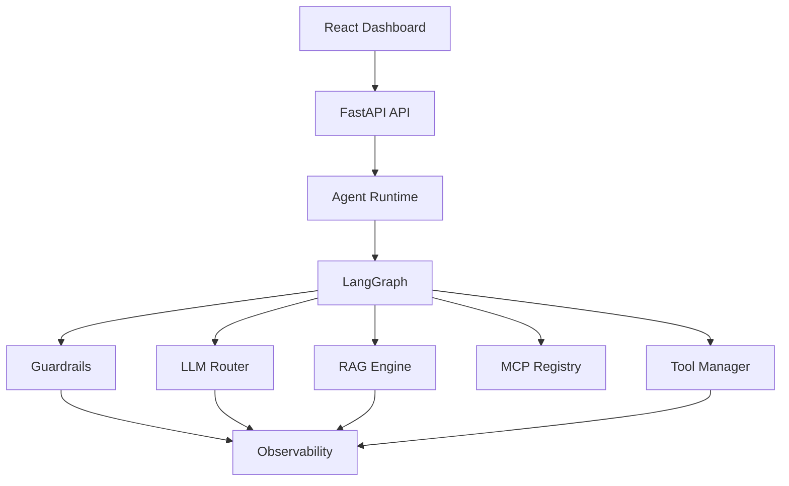
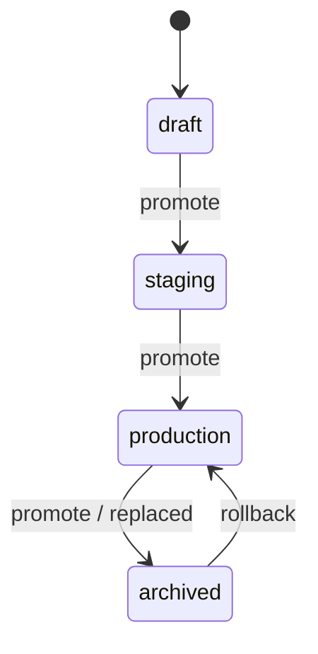
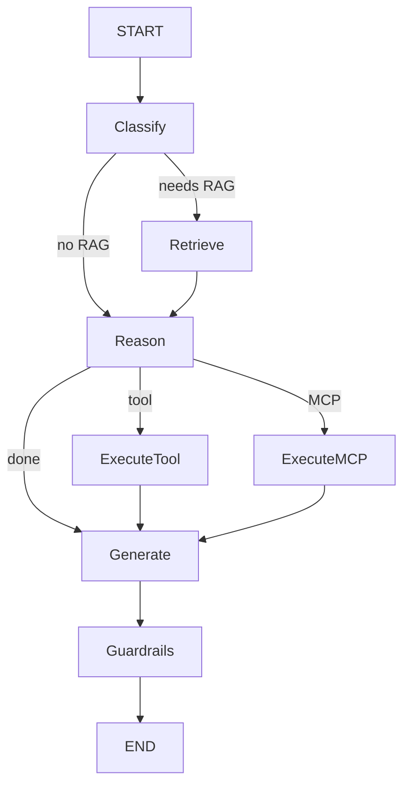

# AgentForge

Production-oriented **AI agent platform** for building, deploying, observing, and evaluating agents.

AgentForge is **not** a chatbot demo. It is a small internal platform that demonstrates modern AI/ML infrastructure: LangGraph orchestration, RAG, tool calling, MCP, model routing with fallbacks, agent versioning, guardrails, tracing, token/cost tracking, evaluation, Docker, Kubernetes, Prometheus, and Grafana.

---

## 1. What AgentForge is

An ops console + runtime for production agents:

1. Create an agent
2. Configure model / system prompt
3. Attach knowledge base (RAG)
4. Attach tools + MCP servers
5. Configure guardrails
6. Deploy versioned agents
7. Chat in the playground
8. Inspect execution traces
9. Monitor latency, errors, tokens, estimated cost
10. Run evaluations
11. Promote / roll back versions

---

## 2. Problem statement

Calling an LLM API once is not enough for production:

- You need retrieval, tools, and policies around every request
- Failures need fallbacks and visibility
- Cost and quality must be measured
- Behavior must be versioned like software

AgentForge packages those concerns into one stack you can run locally and explain in interviews.

---

## 3. Why agent infrastructure is needed

| Concern | Without platform | With AgentForge |
|--------|------------------|-----------------|
| Multi-step reasoning | Ad-hoc scripts | LangGraph workflow |
| Knowledge | Prompt stuffing | RAG + citations |
| Tools / SaaS | Hard-coded | Tool registry + MCP |
| Model outages | Hard failure | Fallback routing |
| Drift | Invisible | Versioning + evals |
| Cost | Unknown | Token + pricing estimates |
| Incidents | Guesswork | Traces + Prometheus |

---

## 4. Architecture



Backend layers (separate packages, not a monolith):

- `app/api` — HTTP
- `app/agents` — LangGraph runtime
- `app/llm` — provider abstraction + router
- `app/rag` — ingest / embed / search
- `app/tools` — tool registry
- `app/mcp` — MCP client + registry
- `app/guardrails` — input/output checks
- `app/observability` — traces + Prometheus
- `app/evaluation` — metrics + runner
- `app/services` — orchestration / versioning
- `app/models` — SQLAlchemy persistence

---

## 5. Agent lifecycle



Each `agent_version` stores system prompt, model, routing, tools, MCP, RAG, and guardrail config. Versions are immutable records — promote/rollback never overwrite history.

---

## 6. RAG architecture

```
PDF/Text → extract → clean → chunk → embed → store (pgvector / JSON vectors)
Query → embed → cosine similarity → top_k (≥ threshold) → citations
```

APIs: `POST /documents`, `GET /documents`, `DELETE /documents/{id}`, `POST /knowledge/search`.

---

## 7. MCP architecture

Real MCP-shaped client:

- register server
- connect
- discover tools
- list / enable tools
- execute tools

Local **mock GitHub MCP server** implements `get_repository`, `list_issues`, `list_pull_requests`, `search_code` so demos work without OAuth. Transport is swappable for real stdio/HTTP MCP.

---

## 8. Model routing

Strategies: `MANUAL` | `CHEAPEST` | `FASTEST` | `FALLBACK`.

- CHEAPEST / FASTEST use **configured pricing & latency metadata** (not fake live RTT).
- FALLBACK: primary → on failure → secondary; tracked in the response and trace.

Providers: OpenAI, Anthropic, Gemini (+ mock mode when keys are absent).

---

## 9. Observability

Every chat creates a `Trace` with spans: agent start → RAG → tools → MCP → LLM → guardrails → response.

Prometheus metrics (bounded labels only): request volume/latency/errors, LLM tokens/cost, tool calls, RAG latency, guardrail failures.

---

## 10. Cost tracking

Pricing lives in **one place**: `app/core/pricing.py`. Costs are always labeled **estimated**.

---

## 11. Evaluation

`POST /evaluations/run` runs a dataset through the live agent and stores:

- answer correctness (token F1)
- faithfulness
- retrieval relevance
- tool success rate
- latency
- estimated cost
- LLM-as-judge **heuristic** (clearly labeled — not claimed as objective truth)

---

## 12. Guardrails

**Input:** length, prompt-injection patterns, blocked patterns  
**Output:** empty response, unsafe patterns, optional grounding when RAG is used  

Failures return controlled errors and appear in the trace.

---

## 13. Versioning

`draft → staging → production → archived`, plus rollback to a prior production version without mutating old rows.

---

## 14. Local setup

### Prerequisites

- Python 3.11+
- Node 20+
- (Optional) Docker / Minikube for full stack

### Backend (SQLite / mock LLM — fastest)

```bash
cd backend
python3.11 -m venv .venv
source .venv/bin/activate
pip install -r requirements.txt
cp ../.env.example ../.env
export APP_ENV=development USE_SQLITE=true LLM_MOCK_MODE=true USE_LOCAL_EMBEDDINGS=false
uvicorn app.main:app --reload --port 8000
```

### Frontend

```bash
cd frontend
npm install
npm run dev
```

Open http://localhost:5173

### Seed demo data

```bash
chmod +x scripts/seed_demo.sh
./scripts/seed_demo.sh
```

---

## 15. Environment variables

See [`.env.example`](.env.example). Important:

| Variable | Purpose |
|----------|---------|
| `DATABASE_URL` | Postgres async URL |
| `USE_SQLITE` | Local/test without Postgres |
| `LLM_MOCK_MODE` | Use mock providers when keys missing |
| `OPENAI_API_KEY` / `ANTHROPIC_API_KEY` / `GOOGLE_API_KEY` | Real providers |
| `AUTH_ENABLED` / `ADMIN_API_KEY` | Protect admin routes |
| `RAG_*` | Chunking / retrieval defaults |

**Never commit API keys.**

---

## 16. Docker setup

```bash
cp .env.example .env
docker compose up --build
```

| Service | URL |
|---------|-----|
| Frontend | http://localhost:3000 |
| API | http://localhost:8000 |
| API docs | http://localhost:8000/docs |
| Prometheus | http://localhost:9090 |
| Grafana | http://localhost:3001 (admin / agentforge) |

```bash
docker compose build
docker compose up -d
docker compose logs -f backend
docker compose down
```

---

## 17. Kubernetes (Minikube)

```bash
minikube start
eval $(minikube docker-env)
docker build -t agentforge-backend:local ./backend
docker build -t agentforge-frontend:local \
  --build-arg VITE_API_URL=http://$(minikube ip):30080/api/v1 \
  ./frontend
kubectl apply -f infra/k8s/agentforge.yaml
kubectl -n agentforge get pods
kubectl -n agentforge rollout status deploy/backend
```

Access:

```bash
minikube service frontend -n agentforge --url
minikube service backend -n agentforge --url
# NodePorts: frontend 30030, backend 30080, grafana 30300
```

---

## 18. API documentation

Interactive: `http://localhost:8000/docs`

### Example — create agent

```bash
curl -s http://localhost:8000/api/v1/agents -H 'Content-Type: application/json' -d '{
  "name": "research-bot",
  "system_prompt": "You are a research agent.",
  "model_provider": "mock",
  "model": "mock-smart",
  "routing_strategy": "MANUAL",
  "tools": ["calculator", "web_search"]
}'
```

### Example — chat

```bash
curl -s http://localhost:8000/api/v1/agents/$AGENT_ID/chat \
  -H 'Content-Type: application/json' \
  -d '{"message":"Please calculate 21 * 2"}'
```

### Example response

```json
{
  "answer": "I used the calculator tool. Result: {'result': 42.0}",
  "agent_id": "...",
  "agent_version": 1,
  "model": "mock-smart",
  "provider": "mock",
  "trace_id": "...",
  "token_usage": {"input_tokens": 40, "output_tokens": 20, "total_tokens": 60},
  "estimated_cost": {
    "estimated_input_cost_usd": 0.000002,
    "estimated_output_cost_usd": 0.000002,
    "estimated_total_cost_usd": 0.000004
  },
  "latency_ms": 45.2,
  "citations": [],
  "fallback_used": false,
  "tool_results": [{"tool": "calculator", "success": true, "output": {"result": 42.0}}]
}
```

---

## 19. Testing

```bash
cd backend
source .venv/bin/activate
ruff check app tests
pytest -q
```

Coverage includes model router, fallback, RAG, tools, agent graph, guardrails, versioning, APIs, cost, evaluation.

---

## 20. CI/CD

GitHub Actions (`.github/workflows/ci.yml`) on push/PR:

- install → lint → pytest
- frontend build
- Docker image builds (no paid cloud required)

```bash
gh repo create agentforge --private --source=. --remote=origin --push
```

---

## 21. Future improvements

- Real MCP stdio/HTTP transports
- Streaming chat (SSE)
- Multi-tenant isolation (org_id + RLS)
- Sandboxed tool workers
- Persistent pgvector indexes + HNSW
- Online eval sampling in production
- Horizontal pod autoscaling on request rate

---

## Agent workflow (LangGraph)



State carries: query, messages, retrieved docs, tool/MCP results, selected model, tokens, cost, trace id, errors, final answer. Max iterations prevent infinite loops.

---

## Interview talking points

See `docs/INTERVIEW.md` for answers to the portfolio Q&A list (why LangGraph, how fallbacks work, how cost is estimated, how you'd scale, etc.).

---

## Resume bullets (implemented)

- Built **AgentForge**, a FastAPI + LangGraph agent platform with RAG (pgvector-ready), tool registry, MCP client, model routing/fallbacks, versioning, and a React ops dashboard.
- Implemented end-to-end observability: per-request traces/spans, Prometheus metrics, Grafana dashboards, and configurable token/cost estimation.
- Shipped Docker Compose + Kubernetes manifests with Postgres, Prometheus, Grafana, GitHub Actions CI (lint, tests, image builds), and an evaluation harness for agent quality.

---

## License

MIT — for portfolio / educational use.
